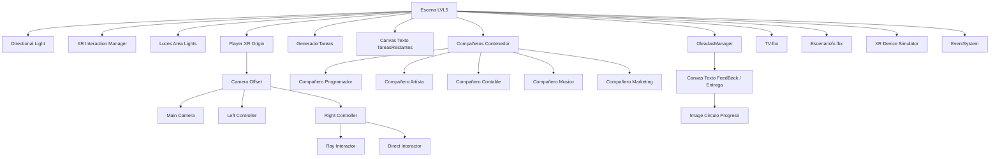
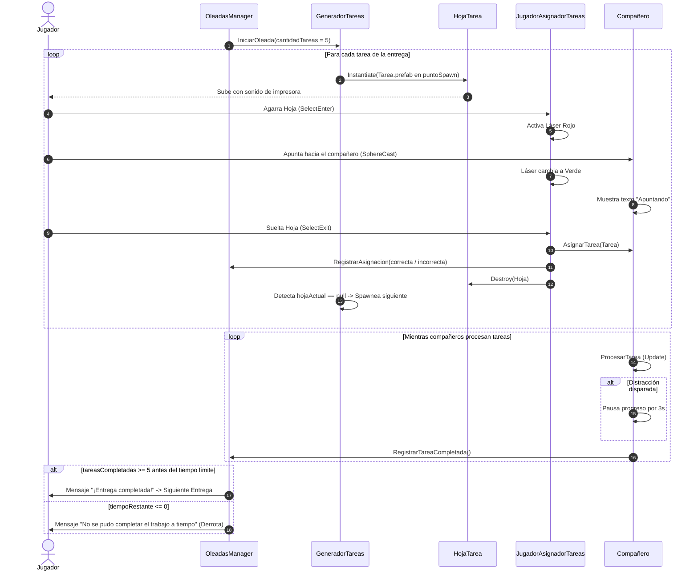

# Estructura y Funcionamiento del LVL 5: Liderazgo y Relevamiento de Tareas

> **Documento de Contexto Técnico y Arquitectura de Nivel**  
> **Proyecto:** EntrevistaVR (01-GestorVR) — Fundación Puerta 18  
> **Nivel:** LVL 5 (`Assets/Scenes/LVL5.unity`)  
> **Enfoque Pedagógico:** Liderazgo, delegación de tareas bajo presión de tiempo y asignación de rol correcto.

---

## Índice de Contenidos

1. [Visión General del Nivel](#1-visión-general-del-nivel)
2. [Arquitectura Espacial y Escenario](#2-arquitectura-espacial-y-escenario)
   - [2.1 Modelo Principal de la Oficina (`Escenariofx.fbx`)](#21-modelo-principal-de-la-oficina-escenariofxfbx)
   - [2.2 Iluminación y Skybox](#22-iluminación-y-skybox)
   - [2.3 Elementos Auxiliares y Mobiliario](#23-elementos-auxiliares-y-mobiliario)
3. [Modelos 3D, Animaciones y Arte](#3-modelos-3d-animaciones-y-arte)
   - [3.1 Avatar de Compañero (`azul ... .fbx`)](#31-avatar-de-compañero-azul--fbx)
   - [3.2 Animator Controller (`Esperando.controller`)](#32-animator-controller-esperandocontroller)
   - [3.3 Materiales Asignados](#33-materiales-asignados)
4. [Jerarquía de la Escena (`LVL5.unity`)](#4-jerarquía-de-la-escena-lvl5unity)
   - [4.1 Árbol de Objetos Raíz (SceneRoots)](#41-árbol-de-objetos-raíz-sceneroots)
   - [4.2 Distribución de los 5 Compañeros en el Espacio](#42-distribución-de-los-5-compañeros-en-el-espacio)
5. [Sistemas y Scripts del LVL 5](#5-sistemas-y-scripts-del-lvl-5)
   - [5.1 `OleadasManager.cs` (Game Manager / Bucle de Entregas)](#51-oleadasmanagercs-game-manager--bucle-de-entregas)
   - [5.2 `GeneradorTareas.cs` (Fábrica e Impresora de Tareas)](#52-generadortareascs-fábrica-e-impresora-de-tareas)
   - [5.3 `HojaTarea.cs` (Objeto Físico Grabable e Interfaz de Papel)](#53-hojatareacs-objeto-físico-grabable-e-interfaz-de-papel)
   - [5.4 `JugadorAsignadorTareas.cs` (Puntero Láser, Detección y Asignación)](#54-jugadorasignadortareascs-puntero-láser-detección-y-asignación)
   - [5.5 `Compañero.cs` (Agente de Trabajo, FSM, Colas y Distracciones)](#55-compañerocs-agente-de-trabajo-fsm-colas-y-distracciones)
   - [5.6 `ResetPlayerPosition.cs` (Utilidad VR de Centrado y Recarga)](#56-resetplayerpositioncs-utilidad-vr-de-centrado-y-recarga)
6. [Flujo y Mecánica de Juego (Game Loop)](#6-flujo-y-mecánica-de-juego-game-loop)
   - [6.1 Ciclo de Vida de una Entrega](#61-ciclo-de-vida-de-una-entrega)
   - [6.2 Ciclo de Vida de una Hoja de Tarea](#62-ciclo-de-vida-de-una-hoja-de-tarea)
   - [6.3 Máquina de Estados del Compañero](#63-máquina-de-estados-del-compañero)
7. [Interfaz de Usuario (UI Diegética y Pantallas)](#7-interfaz-de-usuario-ui-diegética-y-pantallas)
8. [Configuración de Sonido y Audio](#8-configuración-de-sonido-y-audio)

---

## 1. Visión General del Nivel

El **LVL 5** sitúa al jugador en el rol de **líder de equipo** en el centro de una oficina abierta. El jugador se encuentra de pie frente a una máquina / impresora de tareas. A su alrededor hay **5 compañeros de trabajo**, cada uno especializado en una disciplina profesional concreta:
1. **Programador** (`RolTarea.Programador`, ID `0`)
2. **Artista** (`RolTarea.Artista`, ID `1`)
3. **Contable** (`RolTarea.Contable`, ID `2`)
4. **Músico** (`RolTarea.Musico`, ID `3`)
5. **Marketing** (`RolTarea.Marketing`, ID `4`)

El nivel transcurre a lo largo de **3 entregas** (oleadas). En cada entrega se genera un paquete de tareas físicas (hojas de papel). El jugador debe tomar cada hoja con las manos VR, leer qué tarea es y a quién le corresponde, apuntar con el láser al compañero indicado y soltarla para delegarla.

- Si la tarea es **correcta**, el compañero trabaja a velocidad óptima (`1.0x`).
- Si la tarea es **incorrecta**, el compañero se enoja y trabaja a velocidad penalizada (`0.5x`).
- Durante el trabajo, los compañeros pueden sufrir episodios de **distracción** temporizada donde dejan de avanzar hasta recuperarse.
- El jugador gana si completa todas las entregas antes de que el temporizador llegue a cero.

---

## 2. Arquitectura Espacial y Escenario

### 2.1 Modelo Principal de la Oficina (`Escenariofx.fbx`)
- **Asset:** `Assets/Art/3D/Level 5/Escenariofx.fbx`
- **Ubicación en Escena:** Raíz con PrefabInstance `1613661085`.
- **Elementos incluidos en el FBX:**
  - Estructura de la oficina: paredes, suelo, columnas, ventanas, molduras.
  - Mobiliario integrado: escritorios dobles e individuales (`Escritorio.003`), sillas ergonómicas giratorias (`Silla.003`), equipos de cómputo con monitor y teclado (`Computador.003`).
  - Dispensador de agua y bidón.
  - Mesa central y accesorios decorativos (Don Satur, termo, mate, impresora de fax).
- **Texturas asociadas en `Assets/Art/3D/Level 5/`:**
  - `floor_texture_4k.jpg`: Textura de baldosas/piso de madera.
  - `paredes-Abril-4x4.png`: Textura de pintura de paredes y paneles.
  - `Dispenser.png`: Textura del bidón y cuerpo del dispensador de agua.
  - `Don Satur.jpg`: Paquete de galletitas Don Satur sobre la mesa.
  - `Termo.jpg` y `MateTextura.png`: Elementos tradicionales argentinos de oficina.
  - `Fax_textura.jpg`: Máquina de fax/impresora.
  - `Colores_textura_128.jpg` y `1.png`: Paleta de atlas de color plano para detalles.

### 2.2 Iluminación y Skybox
- **Directional Light:** GameObject `Directional Light` (Rotación: `(-0.259, 0.716, -0.334, -0.556)`, posición elevada simulando luz solar angular a través de ventanas).
- **Luces de Área:** GameObject `Luces` con dos fuentes puntuales/de área: `Area Light` y `Area Light (1)` para iluminación de relleno interior.
- **Skybox:** Material `Assets/Art/3D/Level 5/SkyBoxPuerto.mat` con la textura panorámica `Skybox.png` (vista portuaria/exterior de ciudad).
- **Lightmapping y Probes horneados:** Carpeta `Assets/Scenes/LVL5/` con `LightingData.asset`, `Lightmap-0_comp_dir.png`, `ReflectionProbe-0.exr` y `New Lighting Settings.lighting`.

### 2.3 Elementos Auxiliares y Mobiliario
- **Televisor de Oficina (`TV.fbx`):** PrefabInstance `694340342` ubicado al frente (`Z = 6.277`, escala `(7.70, 6.50, 3.71)`), material `Textura tele.mat`. Actúa como monitor de estado o pantalla principal de fondo.
- **Tacho de Basura (`Team3_Sanchez_OfficeBin.fbx`):** PrefabInstance `825650976` emparentado a la estructura del escenario, texturizado con `Team3_Sanchez_Office Bin.png` y normal map `Team3_Sanchez_Office Bin Bmap.jpeg`.

---

## 3. Modelos 3D, Animaciones y Arte

### 3.1 Avatar de Compañero (`azul ... .fbx`)
Todos los compañeros de trabajo utilizan como malla base el personaje humanoide azul estilizado:
- **Modelo base:** `Assets/Animations/LVL5/azul saturado (golpea la mesa).fbx` (GUID `c112b3c66c9105544ab9456d2be5d1c7`).
- **FBX de animaciones de soporte:**
  - `azul esperando.fbx` (GUID `96199965e8d27f5409a7143b1ea553ba`): Loop de respiración y espera en silla.
  - `azul trabajando.fbx` (GUID `47e3d3fe21921eb428048cb01a42a637`): Animación escribiendo en teclado y concentrado.
  - `azul saturado (golpea la mesa).fbx` (GUID `c112b3c66c9105544ab9456d2be5d1c7`): Animación de frustración donde descarga un golpe en el escritorio.
  - `azul boludeando.fbx`: Animación de ocio / distracción (no conectada actualmente en el controller).

### 3.2 Animator Controller (`Esperando.controller`)
- **Ruta:** `Assets/Animations/LVL5/Esperando.controller` (GUID `b6d375749c7f0724caf5e8e163bfe2ea`).
- **Capas:** `Base Layer`.
- **Estados configurados:**
  1. `Esperando` (Default State) $\rightarrow$ reproduce el clip de `azul esperando.fbx`.
  2. `Trabajando` $\rightarrow$ reproduce el clip de `azul trabajando.fbx`.
  3. `Golpeando` $\rightarrow$ reproduce el clip de `azul saturado (golpea la mesa).fbx`.

### 3.3 Materiales Asignados
Los compañeros se diferencian visualmente por el color de su ropa / material ubicado en `Assets/Animations/LVL5/`:
- **Programador:** `Programador.mat` (Azul/Cian)
- **Artista:** `Artista.mat` (Magenta/Violeta)
- **Contable:** `Contable.mat` (Gris/Formal)
- **Músico:** `Musico.mat` (Naranja/Cálido)
- **Marketing:** `Marketing.mat` (Verde)
- **Hoja de Tarea:** `Assets/Materials/LVL5/HojaTarea.mat` (blanco papel con bordes suaves).
- **Progreso UI:** `Assets/Art/2D/LVL5/Circulo.png` (Sprite de anillo radial para el temporizador).

---

## 4. Jerarquía de la Escena (`LVL5.unity`)

### 4.1 Árbol de Objetos Raíz (SceneRoots)
La escena se estructura en 12 raíces principales:

### 4.2 Distribución de los 5 Compañeros en el Espacio
El contenedor `Compañeros` se ubica en el origen `(0, 0, 0)`. Cada compañero está posicionado en su respectivo escritorio alrededor del jugador:

| Nombre / GameObject | Rol Asignado (`RolTarea`) | ID Rol | Posición Local `(X, Y, Z)` | Material |
| :--- | :--- | :--- | :--- | :--- |
| **Compañero 1** (Instancia `995228471`) | Marketing | `4` | `(-2.053, 0.204, 2.444)` | `Marketing.mat` |
| **Compañero 2** (Instancia `1376874468`) | Programador | `0` | `(-2.040, 0.204, 1.167)` | `Programador.mat` |
| **Compañero 3** (Instancia `502112539`) | Artista | `1` | `(-2.053, 0.204, 5.632)` | `Artista.mat` |
| **Compañero 4** (Instancia `1842696406`) | Musico | `3` | `( 2.771, 0.236, 5.632)` | `Musico.mat` |
| **Compañero 5** (Instancia `642850867`) | Contable | `2` | `( 2.771, 0.218, 1.167)` | `Contable.mat` |

*Nota:* El jugador está colocado en `(0.0003, 0, 0.825)`, en el punto medio de la oficina, permitiendo girar sobre su propio eje para alcanzar visualmente a los 5 escritorios.

---

## 5. Sistemas y Scripts del LVL 5

### 5.1 `OleadasManager.cs` (Game Manager / Bucle de Entregas)
- **Responsabilidad:** Administrar las 3 entregas del nivel, el tiempo total por entrega, la condición de victoria/derrota y las estadísticas de aciertos.
- **Estructura interna:**
  - `ConfiguracionEntrega`: Clase serializable con `cantidadTareas` (default: 5) y `tiempoEntrega` (default: 180s).
  - Configuración fija para `entrega1`, `entrega2`, `entrega3`.
  - Singleton `OleadasManager.Instancia`.
- **Mecánicas clave:**
  - En cada entrega reinicia contadores: `tareasAsignadas`, `tareasCorrectas`, `tareasIncorrectas`, `tareasCompletadas`.
  - Dispara a `GeneradorTareas.IniciarOleada(config.cantidadTareas)`.
  - Actualiza el anillo de tiempo radial: `circuloProgreso.fillAmount = tiempoRestante / tiempoTotal` con interpolación de color de blanco a rojo `Color.Lerp(Color.white, Color.red, 1 - sqrt(progreso))`.
  - Si el tiempo llega a 0, llama a `PerderJuego()`.
  - Si `tareasCompletadas >= cantidadTareas`, llama a `CompletarEntrega()`, muestra mensaje en pantalla y pasa a la siguiente entrega tras una breve pausa.

### 5.2 `GeneradorTareas.cs` (Fábrica e Impresora de Tareas)
- **Responsabilidad:** Instanciar las hojas físicas en el punto de salida (`puntoSpawn`) simulando una máquina dispensadora o impresora.
- **Banco de Datos de Tareas (40 tareas predefinidas en código):**
  - **Programador (8):** Reportar bug, Corregir error, Implementar función, Optimizar código, Revisar código, Crear script, Integrar sistema, Solucionar crash.
  - **Artista (8):** Diseñar UI, Crear iconos, Diseñar menú, Ajustar colores, Crear ilustración, Diseñar botones, Mejorar interfaz, Crear fondo.
  - **Contable (8):** Hacer factura, Revisar gastos, Preparar presupuesto, Registrar pago, Revisar cuentas, Calcular impuestos, Organizar facturas, Preparar informe financiero.
  - **Músico (8):** Componer música, Crear melodía, Grabar sonido, Editar audio, Crear efectos de sonido, Mezclar pistas, Crear música de combate, Crear música de menú.
  - **Marketing (8):** Publicar post, Crear campaña, Diseñar anuncio, Analizar redes sociales, Preparar promoción, Crear contenido, Revisar estadísticas, Planificar campaña.
- **Lógica de Generación:**
  - `tareasRestantesPorGenerar`: Contador regresivo de la entrega.
  - Solo genera si `hojaActual == null` y `tareasRestantesPorGenerar > 0`.
  - Configura aleatoriamente la tarea con una duración entre `duracionMin` (4s) y `duracionMax` (10s).

### 5.3 `HojaTarea.cs` (Objeto Físico Grabable e Interfaz de Papel)
- **Prefab:** `Assets/Prefabs/LVL5/Tarea.prefab`.
- **Componentes adjuntos en el Prefab:**
  - `MeshFilter` (cubo aplanado tipo hoja: escala `0.225 x 0.246 x 0.0005`).
  - `MeshRenderer` con material `HojaTarea.mat`.
  - `BoxCollider`.
  - `Rigidbody` (sin gravedad, drag alto = 80).
  - `XRGrabInteractable` (interacción directa y a distancia con manos VR).
  - `AudioSource` (reproduce `printer-line.wav` al spawnear).
  - Hijo `Text (TMP)` que muestra el texto del nombre de la tarea.
- **Comportamiento en Script:**
  - En `Start()` calcula `velocidadSubida = alturaMaxima / sonidoSalida.length`.
  - En `Update()`, si no ha salido (`!salio`), desplaza la hoja hacia arriba con `transform.position += Vector3.up * Time.deltaTime * velocidadSubida`.
  - Al ser agarrada (`OnGrab`), notifica a `JugadorAsignadorTareas.AgarrarTarea()`.
  - Al ser liberada (`OnRelease`), notifica a `JugadorAsignadorTareas.SoltarTarea()`.

### 5.4 `JugadorAsignadorTareas.cs` (Puntero Láser, Detección y Asignación)
- **Responsabilidad:** Manejar la lógica de selección de compañeros mediante un raycast asistido por puntero láser mientras el jugador sostiene una tarea.
- **Funcionamiento del Rayo:**
  - Utiliza `Physics.SphereCast` con origen en la mano que sostiene el papel (`origenRayo.position`), hacia adelante (`origenRayo.forward`), con un radio de `0.1m` y un alcance de `50m`.
  - `LineRenderer` visualiza la trayectoria del rayo:
    - **Rojo:** Apuntando al vacío o sin objetivo válido.
    - **Verde:** Colisionando con el `CapsuleCollider` de un compañero.
  - Al impactar a un compañero, ejecuta `compañero.SetApuntado(true)` para mostrar feedback visual en la UI sobre su cabeza.
- **Asignación:**
  - Al soltar la tarea (`SoltarTarea()`), si había un compañero apuntado:
    1. Instancia un struct/objeto `Tarea` con el nombre, rol y duración.
    2. Consulta si el rol coincide: `compañeroApuntado.EsRolCorrecto(hoja.rolRequerido)`.
    3. Entrega la tarea al compañero: `compañeroApuntado.AsignarTarea(nueva)`.
    4. Notifica a `OleadasManager.Instancia.RegistrarAsignacion(correcta)`.
    5. Destruye el GameObject de la hoja: `Destroy(tareaEnMano.gameObject)`.

### 5.5 `Compañero.cs` (Agente de Trabajo, FSM, Colas y Distracciones)
- **Responsabilidad:** Gestionar el ciclo de trabajo de cada empleado individual.
- **Cola de Tareas:** Implementa `Queue<Tarea> listaTareas`. Puede recibir múltiples tareas seguidas; se procesan en orden FIFO (First-In, First-Out).
- **Máquina de Estados (`Estadocompañero`):**
  - `Esperando`: Sin tareas pendientes. Espera una asignación.
  - `Trabajando`: Ejecutando una tarea correcta. Avanza a `velocidadNormal = 1.0f`.
  - `Enojado`: Ejecutando una tarea incorrecta para su especialidad. Avanza a `velocidadEnojado = 0.5f` (tarda el doble).
  - `Distraido`: Temporalmente desconcentrado. El progreso de la tarea se congela durante `duracionDistraccion = 3f`.
- **Mecanismo de Distracción:**
  - Durante el estado `Trabajando`, corre un temporizador aleatorio entre `tiempoMinDistraccion` (5s) y `tiempoMaxDistraccion` (15s).
  - Al vencer, pasa a `Distraido` e inicia la corrutina `FinalizarDistraccion()`, reanudando el trabajo 3 segundos después.
- **Progreso y Finalización:**
  - En cada `Update()`, `progresoTarea -= Time.deltaTime * velocidad`.
  - Al llegar a 0, completa la tarea, notifica a `OleadasManager.Instancia.RegistrarTareaCompletada()` e inicia la siguiente tarea de su cola.

### 5.6 `ResetPlayerPosition.cs` (Utilidad VR de Centrado y Recarga)
- **Adjunto a:** GameObject `Player`.
- **Función:** Permite al usuario en visor VR o simulador presionar el botón `Reposition` del mando izquierdo para recentrar su orientación y posición frente al escritorio.
- Si se mantiene presionado más de `1.5s`, recarga la escena `LVL5`.

---

## 6. Flujo y Mecánica de Juego (Game Loop)

### 6.1 Ciclo de Vida de una Entrega

---

## 7. Interfaz de Usuario (UI Diegética y Pantallas)

La UI en el LVL 5 es casi en su totalidad **world-space (diegética)**:

1. **Carteles de Cada Compañero:**
   - Montados sobre la cabeza de cada empleado con canvas flotante world-space.
   - `Texto_Rol`: Nombre del rol profesional en negrita (ej: `Programador`).
   - `Texto_tarea` (`textoEstado`): Estado actual y cuenta regresiva de la tarea activa en segundos (ej: `Trabajando (4.2s)` o `Esperando`).
   - `Texto_info`: Feedback visual de asignación (muestra `"Apuntando"` cuando el rayo del jugador hace contacto).

2. **Panel de Estado de Entrega (OleadasManager):**
   - Canvas flotante en la pared frontal/mesa.
   - `Texto Entrega`: Muestra `"Entrega 1"`, `"Entrega 2"`, etc.
   - `Texto FeedBack`: Muestra avisos pedagógicos y transiciones (`"Esperando que finalicen los trabajos..."`, `"¡Entrega completada!"`).
   - `Image` (Círculo de progreso): Imagen radial con `fillAmount` que va disminuyendo con el tiempo y cambiando gradualmente de color blanco a rojo intenso.

3. **Panel de Tareas Restantes:**
   - Canvas ubicado justo al lado de la máquina dispensadora de tareas.
   - `Texto TareasRestantes`: Cuenta regresiva (`Tareas Restantes: 5`, `4`, etc.).

---

## 8. Configuración de Sonido y Audio

El diseño sonoro previsto para el nivel cuenta con clips en `Assets/Sounds/LVL5/`:

- **Mecánica de Impresora:**
  - `printer-line.wav`: Sonido asignado al prefab `Tarea.prefab` al salir de la ranura.
  - `printer-feed.wav`: Sonido de motor de alimentación de papel (archivo de audio disponible en carpeta).
- **Mecánica de Papel y Manipulación:**
  - `Papel arrugado 1.wav`: Sonido reproducido al agarrar la tarea con el controlador.
  - `866344__geoff-bremner-audio__paper-grab.wav`: Alternativa de agarre de hoja.
- **Mecánica de Asignación y Éxito/Error:**
  - `tarea correcta 3.mp3`: Sonido agradable/positivo cuando se asigna la tarea al rol adecuado.
  - `Tarea incorrecta 3.wav`: Sonido de error/chicharra cuando se delega a un rol equivocado.
- **Ambiente:**
  - `Ambiente oficina 2.mp3`: Loop de murmullo y fondo de oficina con teclados y ambiente laboral.
